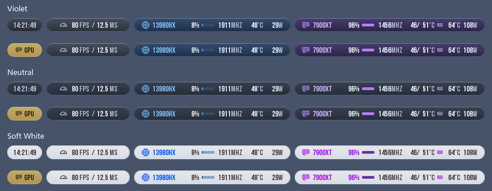
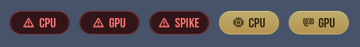

# Glass Islands for RTSS

Four glass-style panels for **RTSS OverlayEditor**, designed for **2560 × 1440** gameplay.

**[⬇️ Download the latest release](https://github.com/ssigpoy/Glass-Islands-for-RTSS/releases/latest)** · [🛠️ Quick setup](#setup) · [简体中文](README.zh-CN.md)

- **🕒 Clock and performance** · Time, FPS, and frame time at a glance.
- **📊 CPU and GPU** · Utilization bars, clocks, temperatures, and power.
- **⚠️ In-game alerts** · The clock gives way to a frame-time spike or sustained-load hint.



## 🎨 Choose a theme

| Theme | Appearance | Layout |
| --- | --- | --- |
| 🟣 Violet | Blue CPU accents, violet GPU accents, and subtle highlights along both edges | [Violet](layouts/violet/) |
| ⚫ Neutral | Dark gray panels with blue and violet model names, icons, and utilization bars | [Neutral](layouts/neutral/) |
| ⚪ Soft White | White panels at 87% opacity, warm graphite readings, and vivid blue and violet accents | [Soft White](layouts/soft-white/) |

All three themes use the same layout and alert rules. Each regular panel is 30 px high, and the full overlay is 1046 px wide. Yellow alerts use a translucent background at about 65% opacity. Red alerts use a deep burgundy background.

<a name="setup"></a>

## 🛠️ Quick setup

1. **Install RTSS with OverlayEditor.** Version **7.3.7 or later** is recommended for the alert formulas. [RTSS download and release notes](https://www.guru3d.com/download/rtss-rivatuner-statistics-server-download/)
2. **Install the font.** Install Adderley Bold, then restart RTSS so the font is available. [Adderley Bold](fonts/Adderley_Bold.ttf)
3. **Copy your theme.** Pick a theme under `layouts/` and copy its `.ovl` and matching `-Atlas.png` into the RTSS overlays folder. The default path is shown below.

   ```text
   C:\Program Files (x86)\RivaTuner Statistics Server\Plugins\Client\Overlays
   ```

4. **Load the layout.** In RTSS, open **Setup → Plugins**, enable `OverlayEditor.dll`, then open it. Use **Layouts → Load** to select the `.ovl` file.
5. **Check the position and font.** At 2560 × 1440 and 1× scaling, the overlay is positioned at the top center. If RTSS uses a different font, select **Raster 3D**, **Adderley Bold**, **13 pt**, and **1×** scaling in the active game profile. Existing OSD offsets can affect placement.

FPS and frame time come from RTSS. Hardware readings come from OverlayEditor's HAL. Live FPS appears while RTSS is monitoring a supported game. Available sensors depend on the GPU, driver, and RTSS version.

### 📐 Using a 1080p screen

The same PNG atlases can be reused at 1920 × 1080. They contain sprites for the panels, icons, bars, and alerts, and the layout controls their position and display size. The included layouts were built for 2560 × 1440. To center the 1046 px strip on a 1920 px canvas at 1× scale, subtract **320 px from every layer’s X position**, including the clock and alert layers. The new left edge is **437 px**. The repository currently ships only the 1440p layouts. The 1080p coordinates are calculated from the layout and have not been tested in-game.

## ⚠️ What the alerts mean



| Alert | Meaning |
| --- | --- |
| 🔴 Red `SPIKE` | A frame-time spike crossed the threshold and neither hardware rule matched. |
| 🔴 Red `CPU` or `GPU` | Utilization rose near a detected spike and matched the CPU or GPU rule. |
| 🟡 Yellow `CPU` or `GPU` | Recent samples repeatedly matched the sustained-load rule for that component. |

The overlay refreshes once per second. Red alerts typically appear for about two seconds. Yellow alerts can remain visible for up to about 15 seconds, clear sooner if the condition drops, and have a cooldown of about 10 seconds for the same alert type. Rolling samples are kept in memory.

> [!NOTE]
> **The alerts are approximate.** Fixed thresholds can miss brief stutters, and CPU/GPU utilization can point to the wrong cause.

<details>
<summary>How stutter is calculated</summary>

1. The layout takes the rolling average of the latest **240 frame-time samples** from RTSS as its baseline.
2. It looks for the highest frame time in a window sized to cover roughly **1.4 seconds** at that baseline, clamped to **6–512 samples**.
3. A spike triggers when that peak is at least **1.75× the baseline** and at least **8 ms above it**. For example, a 10 ms baseline requires a peak of at least 18 ms.

Once a spike is detected, the layout compares hardware utilization with the sample at buffer offset `-2`. The red **CPU** rule requires peak CPU-core utilization of at least 95%, a rise of at least 15 percentage points, and GPU utilization of 85% or less. The red **GPU** rule requires GPU utilization of at least 95%, a rise of at least 12 percentage points, and either peak CPU-core utilization below 90% or a CPU increase of less than 8 percentage points. If neither rule matches, the overlay displays **SPIKE**.

**This is a rough heuristic with limited accuracy.** A changing baseline and fixed thresholds can miss short or mild stutters. The CPU and GPU labels reflect utilization measured near the event, so they can point to the wrong component. Shader compilation, asset streaming, or OS scheduling can also interrupt frame delivery. A yellow GPU alert can appear while a game is meeting its frame cap because sustained high utilization is enough to qualify.

</details>

## ⚙️ Customize the overlay

- The default model labels are `13980HX` and `7900XT`. Edit the **CPU model** and **GPU model** layers in OverlayEditor to match your hardware.
- The layout reads `GPU1` by default. On systems with multiple GPUs, select the gaming GPU's sensors under **Data sources** and update the relevant formula references.
- When hotspot temperature is unavailable, the overlay shows core temperature alone. When VRAM temperature is unavailable, its icon and reading are both hidden.
- If old or garbled graphics appear after replacing a same-named PNG, exit RTSS from the system tray and reload the layout. Use unique atlas filenames for separately distributed themes. [Slick Overlay cache notes](https://github.com/HeyOkay/Slick-Overlay-for-RTSS#notes)

## 🙌 Asset credits and build guide

- [Guide to building an RTSS overlay with an agent (Chinese)](docs/agent-guide.md)
- **Adderley Bold font** was designed by gorohovskiy and published by Dharma Type. The unmodified copy comes from Slick Overlay and includes its [SIL Open Font License 1.1](fonts/OFL.txt). [Font source](https://github.com/HeyOkay/Slick-Overlay-for-RTSS/tree/main/fonts/Adderley)
- **CPU, GPU, FPS gauge, and VRAM icons** come from HeyOkay’s Slick Overlay for RTSS. They were cropped, resized, and recolored for this layout. [MIT license](licenses/LICENSE-Slick-Overlay.txt) · [Icon source](https://github.com/HeyOkay/Slick-Overlay-for-RTSS)
- **Panel base gradient** comes from the Laptop Minibar Smoke background in Faisal’s Apple-Style RTSS Overlays 2.0. The panel sizes, corners, tint, and edge highlights were adapted for this layout. [MIT license](licenses/LICENSE-Apple-Style-RTSS.txt) · [Background source](https://github.com/realHfde/Apple-Style-Inspired-RTSS-Overlay/releases/tag/v2.0)
- **Preview images** were rendered for this repository using the layouts and sample readings.

[Detailed asset credits (Chinese)](docs/third-party-notices.md)

Previews use sample readings. The release is checked for layout references, sprite bounds, and formula structure. Live behavior depends on the game and hardware.
