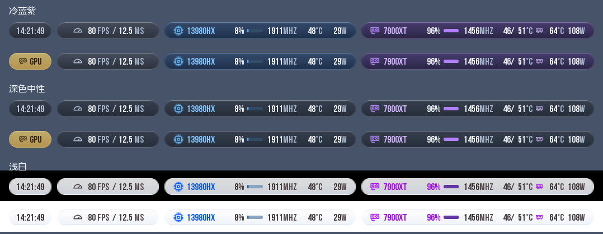
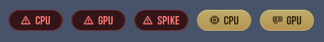

# Glass Islands for RTSS

为 **2560 × 1440** 游戏画面设计的四岛玻璃风格 OSD，使用 **RTSS OverlayEditor**。

**[⬇️ 下载最新版本](https://github.com/ssigpoy/Glass-Islands-for-RTSS/releases/latest)** · [🛠️ 快速安装](#setup) · [English](README.md)

- **🕒 时间与帧率** · 显示时钟、FPS 和帧时间。
- **📊 CPU 与 GPU** · 显示占用率进度条、频率、温度和功耗。
- **⚠️ 游戏内提示** · 出现帧时间尖峰或持续高负载时，在时钟位置显示提示。



## 🎨 选择主题

| 主题 | 外观 | 布局文件 |
| --- | --- | --- |
| 🟣 冷蓝紫 | CPU 深蓝、GPU 深紫，配双沿细高光 | [Violet](layouts/violet/) |
| ⚫ 深色中性 | 四岛统一深灰底，型号、图标与进度条保留蓝紫 | [Neutral](layouts/neutral/) |
| ⚪ 浅白 | 87% 不透明的浅白底、双沿高光、暖石墨灰读数与亮蓝紫点缀 | [Soft White](layouts/soft-white/) |

三版共用相同位置和警告规则。普通岛为 30 px 高，整条宽 1046 px。黄色警告底色约 65% 不透明，红色卡顿提示保留深酒红。

<a name="setup"></a>

## 🛠️ 快速安装

1. **安装带 OverlayEditor 的 RTSS。** 推荐 **RTSS 7.3.7 或更新版本**，以支持警告公式。 [RTSS 发布说明与下载](https://www.guru3d.com/download/rtss-rivatuner-statistics-server-download/)
2. **安装字体。** 安装 [Adderley Bold](fonts/Adderley_Bold.ttf)，退出并重新打开 RTSS，使新字体可选。
3. **复制主题文件。** 从 `layouts/` 选一个主题，把同目录的 `.ovl` 和 `-Atlas.png` 一起放入 RTSS 的 `Plugins\Client\Overlays`。默认目录如下。

   ```text
   C:\Program Files (x86)\RivaTuner Statistics Server\Plugins\Client\Overlays
   ```

4. **加载布局。** 在 RTSS 中打开 `Setup → Plugins`，启用并打开 `OverlayEditor.dll`。用 `Layouts → Load` 加载选定的 `.ovl`。
5. **检查位置与字体。** 游戏以 2560 × 1440 渲染时，布局按 1× 缩放定位在顶部居中。若 RTSS 未采用布局字体，在当前游戏配置中选 Raster 3D、Adderley Bold、13 pt 和 1× 缩放。已有的额外 OSD 偏移也可能影响位置。

FPS 和帧时间使用 RTSS 原生数据，硬件读数由 OverlayEditor 的 HAL 提供。需要进入被 RTSS 正常捕获的游戏才能看到实时帧率。硬件传感器是否可用取决于 GPU、驱动和 RTSS 版本。

### 📐 在 1080p 屏幕上使用

1920 × 1080 可以复用同一套 PNG 图集。面板、图标、进度条和警告的摆放位置与显示尺寸由布局控制。现有布局按 2560 × 1440 编排。在 1× 缩放下，要让这条 1046 px 宽的 OSD 在 1920 px 画面上顶部居中，将所有图层（包括时钟和警告）的 X 坐标统一减 **320 px**，左边界就会从 757 px 移到 **437 px**。仓库目前随附的是 1440p 布局。1080p 坐标按布局计算，尚未在游戏中实测。

## ⚠️ 看懂提示



| 提示 | 含义 |
| --- | --- |
| 🔴 红色 `SPIKE` | 帧时间出现明显尖峰，现有采样不足以指出方向 |
| 🔴 红色 `CPU` / `GPU` | 尖峰附近观察到对应一侧占用突然升高，提示可能方向 |
| 🟡 黄色 `CPU` / `GPU` | 近期多次采样符合持续压力条件，提示可能方向 |

界面每秒刷新一次。红色通常显示约 2 秒。黄色条件持续时最多显示约 15 秒，随后同类冷却约 10 秒，缓解时会提前收起。GPU 持续高占用可能在限帧达标时发生，黄色提示按传感器规则推断压力。布局使用内存中的滚动数据，运行时无需写日志。

> [!NOTE]
> **提示是近似判断。** 固定阈值可能漏掉短暂卡顿，CPU/GPU 占用率变化也可能指向错误的原因。

<details>
<summary>展开查看卡顿计算公式</summary>

红色提示从 RTSS 原生帧时间缓冲区取最近 240 帧的平均帧时间作为基准，再取约 1.4 秒窗口内的峰值。窗口按基准帧时间换算为 6–512 帧。只有峰值同时达到基准的 1.75 倍，并比基准高至少 8 ms，才判为卡顿尖峰。例如，平均帧时间是 10 ms 时，触发阈值是 18 ms。

检测到尖峰后，布局用 CPU 最大核心占用率和 GPU 占用率的变化推测方向。红色 `CPU` 要求 CPU 最大核心占用率至少为 95%，比参考样本高至少 15 个百分点，且 GPU 占用率不超过 85%。红色 `GPU` 要求 GPU 占用率至少为 95%，比参考样本高至少 12 个百分点，同时 CPU 最大核心占用率低于 90% 或增幅小于 8 个百分点。两条规则都使用数据缓冲区的 `-2` 位置作为参考。条件均未满足时显示红色 `SPIKE`。

**这套算法只是近似提示，准确性有限。** 基准会随场景变化，采样和阈值可能漏掉短暂或轻微的卡顿。CPU 和 GPU 标签根据占用率变化推断，无法确认出现尖峰的那一帧究竟卡在哪个环节。着色器编译、资源加载或系统调度也可能造成尖峰。黄色提示反映持续压力，高占用也可能出现在限帧达标时。

</details>

## ⚙️ 自定义 OSD

- 预设型号是 `13980HX` 和 `7900XT`。可在 OverlayEditor 的 `CPU model` 和 `GPU model` 图层换成自己的短型号。
- 显卡监控源默认使用 `GPU1`。多显卡机器可在 `Data sources` 中把对应传感器换成实际运行游戏的显卡，同时核对公式引用。
- 缺少热点温度时只显示核心温度。缺少显存温度时，显存图标和读数会一起隐藏。
- 覆盖同名 PNG 后若出现旧图或乱码，从托盘彻底退出 RTSS，再重新加载。发布不同主题时保持图集文件名唯一。 [Slick Overlay 缓存说明](https://github.com/HeyOkay/Slick-Overlay-for-RTSS#notes)

## 🙌 素材出处与制作指南

- [让 Agent 制作 RTSS OSD 的教程](docs/agent-guide.md)
- **Adderley Bold 字体**由 gorohovskiy 设计、Dharma Type 发布。仓库使用 Slick Overlay 分发的未经修改版本，并附 [SIL Open Font License 1.1](fonts/OFL.txt)。[字体来源](https://github.com/HeyOkay/Slick-Overlay-for-RTSS/tree/main/fonts/Adderley)
- **CPU、GPU、帧率仪表和显存图标**来自 HeyOkay 的 Slick Overlay for RTSS，已按本布局裁切、缩放和着色。[MIT 许可](licenses/LICENSE-Slick-Overlay.txt) · [图标来源](https://github.com/HeyOkay/Slick-Overlay-for-RTSS)
- **面板基础渐变**来自 Faisal 的 Apple-Style RTSS Overlays 2.0 中的 Laptop Minibar Smoke 背景，尺寸、圆角、染色和边缘高光均按本布局调整。[MIT 许可](licenses/LICENSE-Apple-Style-RTSS.txt) · [背景来源](https://github.com/realHfde/Apple-Style-Inspired-RTSS-Overlay/releases/tag/v2.0)
- **预览图**使用本仓库的布局和示例数值渲染。

[完整素材说明](docs/third-party-notices.md)

预览使用示例数值。发布包已检查布局引用、图集边界和公式结构，不同游戏的实时检测仍需在对应环境验证。
